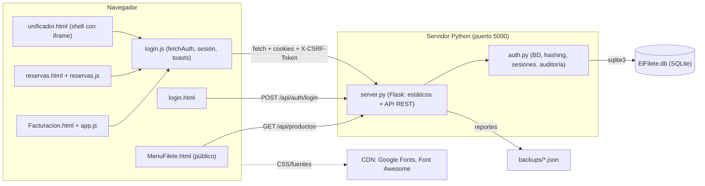
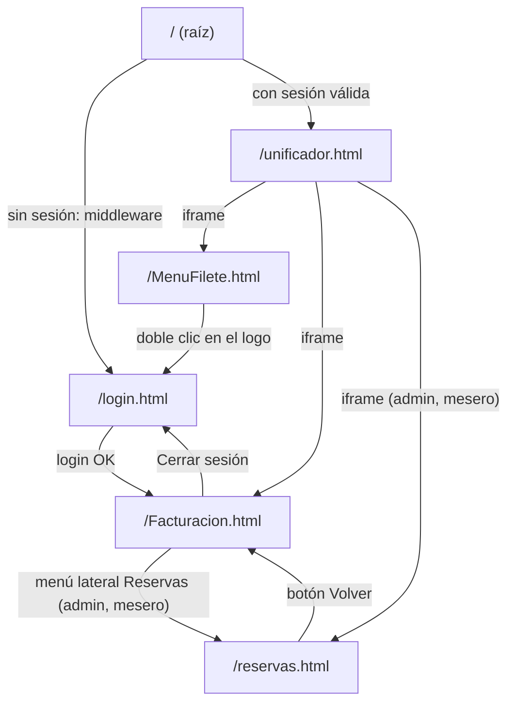
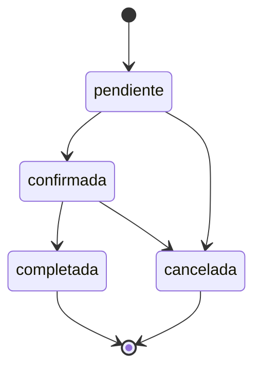
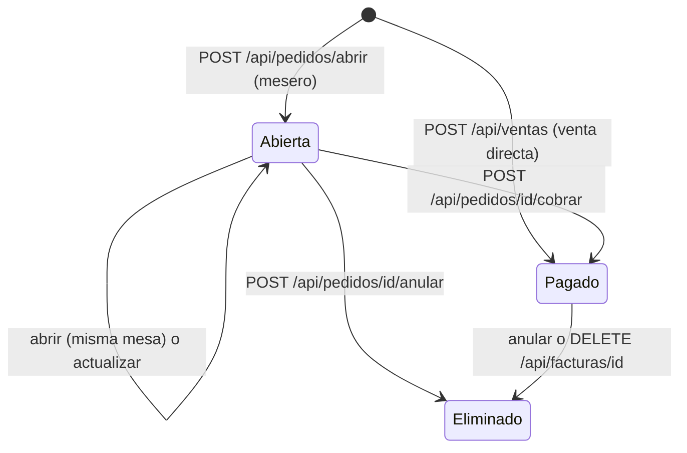
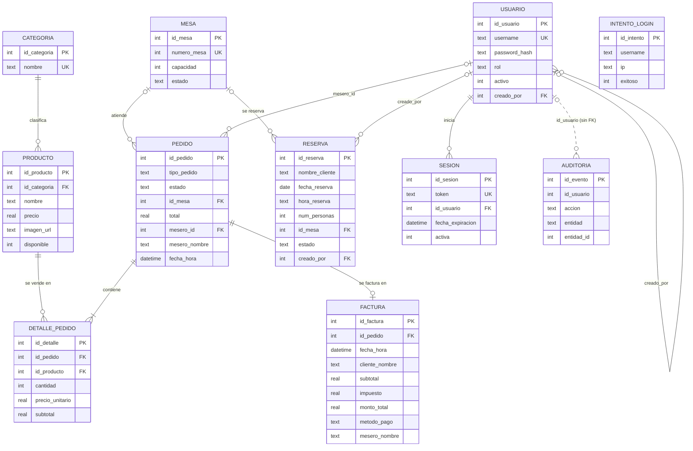
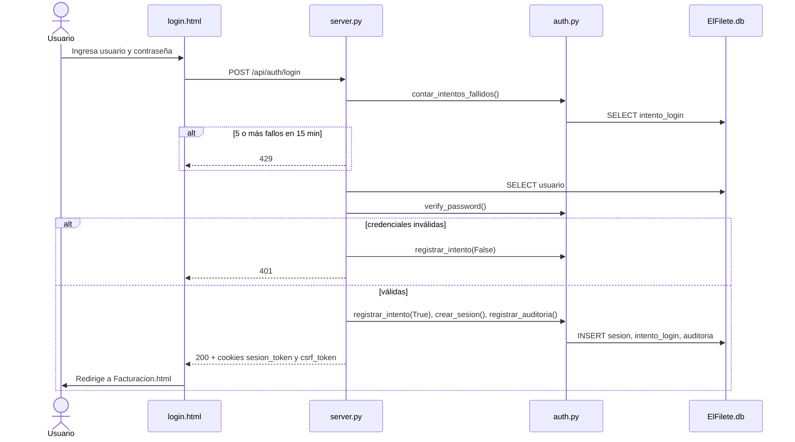
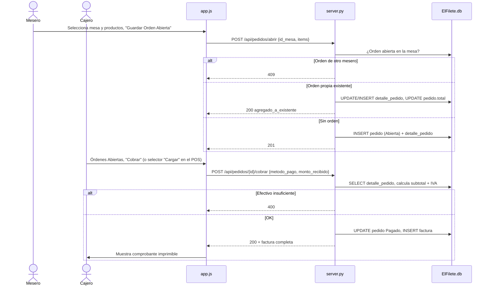
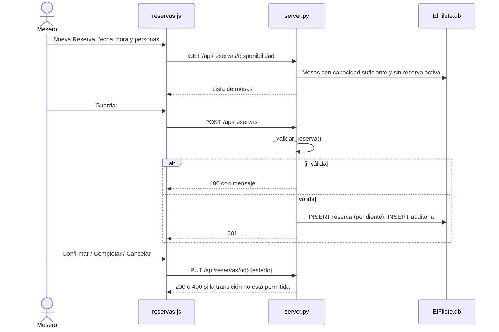

# Documentación Técnica — Sistema POS y Menú Digital "El Filete"

> **Alcance:** este documento se generó a partir del análisis directo del código fuente, de los archivos de configuración y del esquema real de la base de datos `ElFilete.db` (inspeccionada en modo solo lectura). Cuando algo no pudo confirmarse se indica explícitamente como **"No identificado"** o **"Pendiente de verificar"**.
>
> **Fecha del análisis:** 13/11/2026.
> **Convención de referencias:** `archivo.ext L<inicio>-<fin>` indica las líneas del archivo donde está implementado lo descrito.

---

## Índice

1. [Descripción general del proyecto](#1-descripción-general-del-proyecto)
2. [Arquitectura y estructura del proyecto](#2-arquitectura-y-estructura-del-proyecto)
3. [Tecnologías y dependencias](#3-tecnologías-y-dependencias)
4. [Frontend](#4-frontend)
5. [Backend y lógica de negocio](#5-backend-y-lógica-de-negocio)
6. [Base de datos](#6-base-de-datos)
7. [Conexiones e integraciones](#7-conexiones-e-integraciones)
8. [Autenticación y seguridad](#8-autenticación-y-seguridad)
9. [Configuración e instalación](#9-configuración-e-instalación)
10. [Flujos principales del sistema](#10-flujos-principales-del-sistema)
11. [Estado actual y aspectos pendientes](#11-estado-actual-y-aspectos-pendientes)
12. [Guía para futuros desarrolladores](#12-guía-para-futuros-desarrolladores)
13. [Anexo: archivos analizados](#13-anexo-archivos-analizados)

---

## 1. Descripción general del proyecto

### 1.1 Propósito

Aplicación web de **punto de venta (POS)** y **menú digital** para el restaurante "El Filete" (moneda: córdobas, `C$`; IVA del 15 %). Centraliza en un único servidor local:

- La exhibición pública del menú a clientes.
- La toma de órdenes por parte de meseros (órdenes "abiertas" por mesa).
- El cobro y la facturación por parte de cajeros/administrador.
- La gestión de reservas, usuarios, catálogo de productos y reportes de ventas.

### 1.2 Problema que resuelve

Sustituye el registro manual de pedidos y facturas por un sistema con persistencia relacional, control de acceso por roles (admin, cajero, mesero), trazabilidad (tabla `auditoria`) y reportes automáticos (diario, semanal, mensual) con copia de seguridad en JSON.

### 1.3 Funcionalidades principales implementadas

| Módulo | Descripción | Archivos principales |
|---|---|---|
| Menú digital público | Lista de productos disponibles agrupados por categoría (acordeón), tema claro/oscuro | `MenuFilete.html`, `menu.css` |
| Autenticación | Login con cookie de sesión HttpOnly + token CSRF, bloqueo por intentos fallidos | `login.html`, `login.js`, `auth.py`, `server.py` |
| Punto de venta | Catálogo con búsqueda y filtros, carrito, cálculo de IVA y cambio, venta directa | `Facturacion.html`, `app.js` |
| Órdenes abiertas | El mesero guarda órdenes por mesa; el cajero las carga y las cobra | `app.js`, `server.py` |
| Historial de facturas | Listado, vista/impresión de comprobante, eliminación y anulación | `app.js`, `server.py` |
| Reservas | Alta, cambio de estado, disponibilidad de mesas, tiquete imprimible | `reservas.html`, `reservas.js`, `server.py` |
| Reportes | Diario, semanal y mensual, exportación CSV, impresión y backup JSON | `app.js`, `server.py` |
| Administración de menú | CRUD de productos (borrado lógico si tiene ventas) | `app.js`, `server.py` |
| Gestión de usuarios | Alta y desactivación/eliminación de usuarios (solo admin) | `app.js`, `server.py` |

### 1.4 Tecnologías

- **Backend:** Python 3 + Flask + Flask-CORS; SQLite mediante el módulo estándar `sqlite3`.
- **Frontend:** HTML5, CSS3 y JavaScript *vanilla* (sin framework ni empaquetador).
- **Recursos externos (CDN):** Google Fonts (Inter) y Font Awesome 6.4.0.
- **Utilidades:** script por lotes de Windows (`iniciar.bat`) y un script opcional de optimización de imágenes con Pillow.

### 1.5 Estado actual

Proyecto **funcional en entorno local** (la base de datos contiene facturas reales de prueba entre el 05/11/2026 y el 13/11/2026). Sin embargo:

- Se incorporó el script de inicialización `init_db.py`, permitiendo inicializar o restaurar la base de datos completa (`ElFilete.db`) en modo limpio con `python init_db.py --force` o de manera interactiva.
- El `README.md` original está **desactualizado** respecto al código (referencias a `Filete2.db`, modo *fallback* inexistente, número de mesas).
- No existen pruebas automatizadas, control de dependencias formal (`requirements.txt`) ni configuración de producción.

---

## 2. Arquitectura y estructura del proyecto

### 2.1 Arquitectura general

Arquitectura **cliente-servidor monolítica** de dos capas lógicas más persistencia:

- Un único proceso Flask (`server.py`) que **sirve los archivos estáticos** (HTML/CSS/JS/imágenes) y además expone una **API REST JSON** bajo `/api/...`.
- El frontend son **páginas HTML independientes** (multi-página) que consumen la API con `fetch`.
- La persistencia es un archivo **SQLite** (`ElFilete.db`) en la raíz del proyecto.



### 2.2 Árbol de directorios comentado

Se omiten `__pycache__/` (bytecode generado) y el listado completo de imágenes.

```text
el_filete3/
├── server.py              # Backend Flask: middleware de auth/CSRF, API REST, servicio de estáticos
├── auth.py                # Conexión a SQLite, hashing PBKDF2, sesiones, intentos de login, auditoría
├── init_db.py             # Inicialización y siembra de ElFilete.db (categorías, mesas, productos, usuarios)
├── ElFilete.db            # Base de datos SQLite real usada por el sistema (12 tablas)
├── iniciar.bat            # Lanzador para Windows: verifica Python/Flask, abre navegador y arranca server.py
│
├── login.html             # Pantalla de inicio de sesión (script embebido que llama a /api/auth/login)
├── login.css              # Estilos de la pantalla de login
├── login.js               # Utilidades globales: fetchAuth, CSRF, usuario actual, toasts, helpers de rol
│
├── MenuFilete.html        # Menú digital público (script embebido, consume GET /api/productos)
├── menu.css               # Estilos del menú público (temas claro/oscuro)
│
├── unificador.html        # Shell con barra superior e <iframe> para navegar Menú / POS / Reservas
├── Facturacion.html       # SPA del POS: vistas POS, órdenes abiertas, historial, reportes, menú admin, usuarios
├── Facturacion.css        # Estilos del POS (también reutilizados por reservas.html)
├── app.js                 # Lógica completa del POS (≈1 537 líneas)
│
├── reservas.html          # Página de gestión de reservas
├── reservas.js            # Lógica de reservas (listado, filtros, alta, estados, tiquete)
│
├── optimizar-imagenes.py  # Utilidad opcional (Pillow) para comprimir imágenes JPG
├── README.md              # Documentación previa (desactualizada, ver §11)
├── .vscode/settings.json  # Configuración del editor (gestor de entornos Python: sistema)
└── Imagenes/              # Fotografías de productos (.jpg/.webp) y Logo.jpg
```

> **Nota:** el directorio `backups/` **no existe** actualmente; lo crea `server.py` la primera vez que se genera un reporte.

### 2.3 Responsabilidad de cada componente

| Componente | Responsabilidad |
|---|---|
| `server.py` | Punto de entrada. Define la app Flask, CORS, cabeceras de seguridad, middleware de autenticación y CSRF, todas las rutas `/api/*`, la lógica de negocio (ventas, órdenes, reservas, reportes) y el servicio de archivos estáticos. |
| `auth.py` | Capa de acceso a datos de bajo nivel y seguridad: `get_db()`, `hash_password()`, `verify_password()`, gestión de sesiones, registro de intentos de login y de auditoría. |
| `login.js` | Biblioteca cliente compartida por `Facturacion.html`, `reservas.html` y `unificador.html`. Expone funciones en `window`. |
| `app.js` | Controlador de la SPA `Facturacion.html` (estado del carrito, render de vistas, llamadas a la API). |
| `reservas.js` | Controlador de `reservas.html`. |
| HTML con script embebido | `login.html` y `MenuFilete.html` contienen su propia lógica sin archivos JS externos. |

### 2.4 Relación entre módulos

- `server.py` **importa** de `auth.py` (`server.py L22-27`).
- Las páginas protegidas cargan **primero** `login.js` y **luego** su controlador (`Facturacion.html L399-400`, `reservas.html L155-156`), porque `app.js` y `reservas.js` dependen de `window.fetchAuth`, `window.cargarUsuarioActual`, `window.showToast`, `window.esAdmin`, etc.
- `unificador.html` incrusta `MenuFilete.html`, `Facturacion.html` y `reservas.html` en un `<iframe name="main-frame">`.

### 2.5 Patrones identificados

| Patrón | Dónde |
|---|---|
| **Middleware / interceptores** (`before_request`, `after_request`, `teardown_appcontext`) | `server.py L278-328` |
| **Conexión por petición** almacenada en `flask.g` | `server.py L278-287` |
| **Funciones "core" reutilizables** separadas de las rutas (`_core_crear_venta`, `_core_eliminar_factura`, `_core_reporte_*`, `_validar_reserva`) | `server.py L66-264` |
| **Borrado lógico** (desactivar en lugar de eliminar si hay historial) | Productos `server.py L1074-1087`; usuarios `server.py L495-518` |
| **Máquina de estados** para reservas | `server.py L664-671` |
| **Double-submit cookie** para CSRF | `server.py L303-317`, `login.js L49-74` |
| **Wrapper de fetch** centralizado | `login.js L49-74` |
| **SPA por pestañas** (mostrar/ocultar secciones) | `app.js L1493-1532` |

No se identificó un patrón MVC formal ni capas de servicio/repositorio separadas: el SQL se escribe directamente dentro de las rutas.

---

## 3. Tecnologías y dependencias

### 3.1 Backend

| Tecnología | Versión | Uso | Fuente |
|---|---|---|---|
| Python | 3.15.2 instalado en el entorno analizado; `iniciar.bat` exige "3.9+" | Lenguaje del servidor | `python --version`, `iniciar.bat L15` |
| Flask | 3.1.3 (instalada) — **sin versión fijada en el proyecto** | Framework web, rutas, `g`, cookies | `server.py L271` |
| Flask-CORS | 6.0.5 (instalada) — **sin versión fijada** | CORS para `localhost:5000` / `127.0.0.1:5000` | `server.py L272-276` |
| `sqlite3` (stdlib) | — | Acceso a la base de datos | `auth.py L5` |
| `hashlib`, `hmac`, `secrets` (stdlib) | — | PBKDF2, comparación en tiempo constante, tokens | `auth.py L1-4` |
| `mimetypes` (stdlib) | — | Corrige MIME de `.js/.css/.html` en Windows | `server.py L14-17` |
| Pillow (`PIL`) | No fijada | Solo para `optimizar-imagenes.py` (opcional) | `optimizar-imagenes.py L1` |

### 3.2 Frontend

| Tecnología | Versión | Uso |
|---|---|---|
| HTML5 / CSS3 / JavaScript ES2017+ (`async/await`, `fetch`) | — | Toda la interfaz |
| Font Awesome | 6.4.0 (CDN cdnjs) | Iconografía |
| Google Fonts — Inter | CDN | Tipografía |
| `localStorage` | — | Persistencia del tema (`filete-tema`) |

### 3.3 Gestión de dependencias

- **No existe** `requirements.txt`, `pyproject.toml`, `package.json` ni entorno virtual en el proyecto.
- La única "gestión" es `iniciar.bat L20-26`: si `import flask, flask_cors` falla, ejecuta `pip install flask flask-cors` (última versión disponible).
- El frontend no tiene dependencias instalables: todo se carga desde CDN, por lo que **requiere conexión a Internet** para iconos y fuentes (la funcionalidad sigue operando sin ellos).

---

## 4. Frontend

### 4.1 Estructura

Aplicación **multi-página**; cada página carga su propio CSS y scripts.

| Página | Acceso | Scripts | Estilos |
|---|---|---|---|
| `MenuFilete.html` | Público | Embebido | `menu.css` |
| `login.html` | Público | Embebido | `login.css` |
| `unificador.html` | Autenticado | `login.js` + embebido | Embebido (`<style>`) |
| `Facturacion.html` | Autenticado | Embebido (tema) + `login.js` + `app.js` | `Facturacion.css` |
| `reservas.html` | Autenticado | Embebido (tema) + `login.js` + `reservas.js` | `Facturacion.css` |

### 4.2 Navegación y rutas



- **Rutas de servidor:** cualquier ruta no-API se resuelve como archivo dentro de la raíz del proyecto (`server.py L337-346`). Si no existe y no es un recurso estático, redirige a `/login.html`.
- **Navegación interna del POS** (`Facturacion.html`): pestañas con `data-tab` → secciones `#<tab>-view`, gestionadas por `_navegar(tab)` (`app.js L1493-1532`):

| `data-tab` | Vista | Roles que la ven (frontend) | Carga de datos al entrar |
|---|---|---|---|
| `pos` | Punto de venta | Todos | `recargarMesas()` |
| `ordenes-abiertas` | Órdenes abiertas | admin, cajero | `cargarOrdenesAbiertas()` |
| `inventory` | Historial de facturas | Todos | `cargarFacturas()` |
| *(enlace)* | Reservas → `reservas.html` | admin, mesero | — |
| `reportes` | Reportes | admin, cajero | — |
| `menu-admin` | Editar menú | admin | `cargarMenuAdmin()` |
| `usuarios` | Usuarios | admin | `cargarUsuarios()` |

La visibilidad por rol se aplica con el atributo `data-rol-requerido="admin,cajero"` (`app.js L58-61`). **Es solo cosmética**: la autorización real está en el backend.

### 4.3 Gestión del estado

No hay librería de estado. Se usan variables globales de módulo en `app.js L5-11` y `L735`, `L901-902`:

| Variable | Contenido |
|---|---|
| `catalogo`, `categorias`, `mesas` | Datos cargados de la API |
| `order` | Carrito actual: `[{id_producto, nombre, precio, cantidad, ...}]` |
| `currentCategory`, `searchQuery` | Filtros del catálogo |
| `ordenAbertaActual` | Orden abierta cargada para "agregar productos" (flujo de mesero) |
| `_ordenParaCobrarId` | Orden abierta cargada en el POS por un cajero para cobrarla |
| `_cobrarOrdenId`, `_cobrarOrdenTotal` | Estado del modal "Cobrar orden" |
| `window.usuarioActual` | Usuario autenticado (de `/api/auth/me`), definido en `login.js` |
| `window._ultimoReporte` | Último reporte generado (para CSV) |
| `localStorage['filete-tema']` | Tema `dark`/`light`, sincronizado entre páginas e iframes vía evento `storage` |

En `reservas.js`: `reservasCache` y `idReservaACancelar`.

### 4.4 Comunicación con el backend

Toda petición autenticada pasa por `window.fetchAuth(url, opts)` (`login.js L49-74`):

1. Si hay `body` y no hay `Content-Type`, añade `application/json`.
2. Para `POST`, `PUT` y `DELETE` añade la cabecera `X-CSRF-Token` con el valor de la cookie `csrf_token`.
3. Envía cookies con `credentials: 'same-origin'`.
4. Si la respuesta es **401**, redirige a `login.html`.

Excepciones que usan `fetch` directo: `login.html L77` (login) y `MenuFilete.html L104` (menú público; si la página se abre como `file://` usa `http://localhost:5000` como base, `L52`).

### 4.5 Formularios, validaciones e interacción

| Formulario | Ubicación | Validación en cliente | Endpoint |
|---|---|---|---|
| Login | `login.html L19-38` | `required`; mostrar/ocultar contraseña | `POST /api/auth/login` |
| Carrito/cobro | `Facturacion.html L83-155`, `app.js L361-467` | Carrito no vacío; en efectivo, monto recibido ≥ total | `POST /api/ventas` o `POST /api/pedidos/abrir` |
| Cobrar orden abierta (modal) | `Facturacion.html L361-373`, `app.js L1423-1483` | Monto ≥ total estimado (subtotal + 15 %) | `POST /api/pedidos/<id>/cobrar` |
| Producto | `Facturacion.html L328-343`, `app.js L1340-1387` | `required`, `min=0` | `POST /api/productos`, `PUT /api/productos/<id>` |
| Usuario | `Facturacion.html L346-358`, `app.js L1389-1421` | `required` (la longitud mínima la valida el servidor) | `POST /api/usuarios` |
| Reserva | `reservas.html L73-79`, `reservas.js L241-284` | `required`, hora `min=12:00 max=22:00`, personas 1–30, fecha mínima hoy | `POST /api/reservas` |

Otros mecanismos: notificaciones *toast* (`login.js L22-46`), confirmaciones con `confirm()`, modal propio de confirmación de cancelación de reservas, impresión de comprobantes con `window.print()` y de reportes/tiquetes mediante un `iframe` oculto.

### 4.6 Comportamiento del POS según rol (`app.js L93-106`, `L361-467`)

- **Mesero:** se ocultan métodos de pago y efectivo; el botón principal pasa a "Guardar Orden Abierta" y envía a `/api/pedidos/abrir`. En el selector de mesas, las mesas ocupadas por otro mesero aparecen deshabilitadas (`app.js L142-170`).
- **Cajero/Admin:** ven métodos de pago; el botón "Cobrar" crea una venta directa (`/api/ventas`) o, si se cargó una orden abierta desde el selector "Cargar", la cobra (`/api/pedidos/<id>/cobrar`).

---

## 5. Backend y lógica de negocio

### 5.1 Arquitectura del backend

Todo el backend vive en **un único archivo** `server.py` (1 175 líneas) dentro de un bloque `try: ... except ImportError` (`L270-1172`). Componentes:

| Componente | Líneas | Descripción |
|---|---|---|
| Constantes | `L19-31` | `BASE_DIR`, `DB_NAME = "Filete2.db"` (solo informativo, ver §11), `IVA = 0.15` |
| Funciones de dominio | `L34-264` | Lógica reutilizable sin dependencia de Flask |
| Middleware | `L278-328` | Conexión BD, cabeceras, autenticación y CSRF |
| Rutas | `L330-1158` | Controladores HTTP |
| Arranque | `L1160-1175` | `run_server()` → migración + `app.run(host='0.0.0.0', port=5000, debug=True)` |

`auth.py` actúa como módulo de servicios de seguridad/persistencia.

### 5.2 Funciones de dominio

| Función | Líneas | Responsabilidad |
|---|---|---|
| `_orden_abierta_de_mesa(cur, id_mesa)` | `L34-40` | Devuelve la orden con estado `Abierta` de una mesa |
| `_migrar_mesero_ids()` | `L43-63` | Migración al arrancar: rellena `pedido.mesero_id` en pedidos antiguos usando el nombre del mesero, solo si el nombre es único |
| `_core_crear_venta(conn, data, mesero_id, mesero_nombre)` | `L66-137` | Venta directa: valida productos, calcula subtotal/IVA/total/cambio, inserta `pedido` (Pagado) + `detalle_pedido` + `factura` en una transacción |
| `_core_eliminar_factura(...)` | `L140-158` | Borra factura, detalles y pedido, y registra auditoría |
| `_core_reporte_diario(conn, fecha)` | `L161-184` | Totales del día, por método de pago y top 10 productos |
| `_core_reporte_mensual(conn, anio, mes)` | `L187-224` | Totales del mes, por día, por método, top 10 y ventas por categoría |
| `_validar_reserva(conn, data)` | `L227-264` | Reglas de negocio de reservas (ver §5.4) |

### 5.3 Endpoints de la API

Leyenda de acceso: **Público** = sin sesión; **Auth** = cualquier usuario autenticado; roles explícitos cuando el endpoint los comprueba. Todos los métodos `POST/PUT/DELETE` autenticados exigen además la cabecera `X-CSRF-Token` igual a la cookie `csrf_token` (403 si no coincide).

#### Autenticación

| Método | Ruta | Acceso | Parámetros | Respuestas | Líneas |
|---|---|---|---|---|---|
| POST | `/api/auth/login` | Público | JSON `{username, password}` | 200 `{id_usuario, username, rol, nombre_completo}` + cookies `sesion_token` y `csrf_token`; 401 credenciales inválidas; 429 tras 5 fallos en 15 min (por usuario+IP) | `L348-384` |
| POST | `/api/auth/register` | Público | JSON `{username, password, nombre_completo?}` | 201; 400 (usuario < 3 caracteres o no alfanumérico/`_`, contraseña < 8); 409 duplicado. Siempre crea rol `mesero` | `L386-416` |
| POST | `/api/auth/logout` | Auth | — | 200; invalida sesión y borra cookies | `L418-428` |
| GET | `/api/auth/me` | Auth | — | 200 datos del usuario; renueva la sesión si expira en < 60 min | `L430-442` |

#### Usuarios (solo admin)

| Método | Ruta | Validaciones / reglas | Respuestas | Líneas |
|---|---|---|---|---|
| GET | `/api/usuarios` | rol admin | 200 lista (sin hash) | `L444-451` |
| POST | `/api/usuarios` | username ≥ 3 alfanumérico/`_`; contraseña ≥ 8; rol ∈ {admin, cajero, mesero}; solo un admin activo | 201 `{id_usuario, rol}`; 400; 403; 409 | `L453-493` |
| DELETE | `/api/usuarios/<uid>` | No puede eliminarse a sí mismo. Si tiene reservas o auditoría → `activo = 0`; si no → `DELETE` | 200 `{accion}`; 404; 409 | `L495-518` |

#### Catálogo y mesas

| Método | Ruta | Acceso | Descripción | Líneas |
|---|---|---|---|---|
| GET | `/api/categorias` | Público | Lista de categorías | `L718-722` |
| GET | `/api/productos` | Público | Productos con `disponible = 1` + nombre de categoría. **Ignora** el parámetro `?todos=1` que envía el frontend | `L724-738` |
| POST | `/api/productos` | admin | JSON `{nombre, precio>0, id_categoria>0, descripcion?, imagen_url?}` → 201 | `L1038-1054` |
| PUT | `/api/productos/<pid>` | admin | Actualización parcial de `nombre, descripcion, precio, imagen_url, id_categoria, disponible` | `L1056-1072` |
| DELETE | `/api/productos/<pid>` | admin | Si aparece en `detalle_pedido` → `disponible = 0`; si no → `DELETE` | `L1074-1087` |
| GET | `/api/mesas` | Auth | Mesas + orden abierta (`orden_abierta_id`, `ocupada_por_id`, `ocupada_por_nombre`) | `L740-754` |

#### Ventas, pedidos y facturas

| Método | Ruta | Acceso | Descripción | Líneas |
|---|---|---|---|---|
| POST | `/api/ventas` (alias `/api/pedidos`) | Auth (sin chequeo de rol) | Venta directa pagada. JSON `{items:[{id_producto, cantidad, observacion?}], id_mesa?, tipo_pedido?, cliente_nombre?, cliente_ruc_cedula?, metodo_pago?, descuento?, propina?, monto_recibido?}`. 400 si la mesa tiene orden abierta o un producto no existe | `L580-590` |
| POST | `/api/pedidos/abrir` | Auth | Crea orden `Abierta`. Si la mesa ya tiene orden del **mismo** mesero, fusiona productos (200, `agregado_a_existente: true`); si es de otro mesero → 409 | `L759-843` |
| GET | `/api/pedidos/abiertos` | Auth | Órdenes abiertas con sus ítems | `L845-865` |
| GET | `/api/pedidos/<id>` | Auth | Pedido + ítems | `L867-883` |
| POST | `/api/pedidos/<id>/cobrar` | admin, cajero | JSON `{cliente_nombre?, metodo_pago?, monto_recibido?}`. Recalcula subtotal desde `detalle_pedido`, IVA 15 %, valida efectivo ≥ total, crea factura y pone el pedido en `Pagado`. Devuelve la factura completa | `L885-956` |
| POST | `/api/pedidos/<id>/anular` | admin, cajero | **Borra físicamente** factura, detalles y pedido (abierto o pagado) y registra auditoría | `L958-977` |
| POST | `/api/pedidos/<id>/actualizar` | Auth (mesero solo su orden) | Agrega ítems a una orden abierta y recalcula el total | `L979-1033` |
| GET | `/api/facturas` | Auth | Mesero: solo facturas de sus pedidos (`mesero_id`). Otros: todas | `L520-538` |
| GET | `/api/facturas/<id>` | Auth (mesero solo las suyas) | Factura + ítems | `L540-563` |
| DELETE | `/api/facturas/<id>` | admin | Requiere cabecera `X-Confirm-Delete: yes` | `L565-578` |

#### Reservas

| Método | Ruta | Acceso | Descripción | Líneas |
|---|---|---|---|---|
| GET | `/api/reservas?fecha=&estado=` | Auth | Lista con número de mesa y creador | `L592-607` |
| POST | `/api/reservas` | Auth | Valida con `_validar_reserva`; estado inicial `pendiente` | `L609-630` |
| PUT | `/api/reservas/<rid>` | Auth (mesero solo las suyas) | Edición parcial y/o cambio de estado (máquina de estados) | `L632-680` |
| DELETE | `/api/reservas/<rid>` | admin o creador | Borrado físico | `L682-696` |
| GET | `/api/reservas/disponibilidad?fecha=&hora=&personas=` | Auth | Mesas con capacidad suficiente y sin reserva activa en esa fecha/hora exactas | `L698-716` |

#### Reportes

| Método | Ruta | Acceso | Parámetros | Líneas |
|---|---|---|---|---|
| GET | `/api/reportes/diario` | admin, cajero | `fecha` (por defecto hoy) | `L1092-1107` |
| GET | `/api/reportes/semanal` | admin | `fecha_inicio` (7 días hacia adelante) | `L1109-1141` |
| GET | `/api/reportes/mensual` | admin | `mes`, `anio` | `L1143-1158` |

Cada reporte se guarda además en `backups/reporte_<tipo>_<fecha>.json`; los errores de escritura se ignoran silenciosamente.

#### Estáticos

| Método | Ruta | Descripción | Líneas |
|---|---|---|---|
| GET | `/` | Con sesión → `/unificador.html`; sin sesión el middleware redirige a `/login.html` | `L330-335` |
| GET | `/<path>` | Sirve cualquier archivo existente de la raíz del proyecto | `L337-346` |

### 5.4 Reglas de negocio principales

- **Cálculo de importes** (`server.py L88-107`, `L908-918`):

  $$\text{subtotal} = \sum \text{precio}\times\text{cantidad},\quad \text{impuesto} = \text{subtotal}\times 0.15,\quad \text{total} = \text{subtotal} + \text{impuesto} + \text{propina} - \text{descuento}$$

  Todos los valores se redondean a 2 decimales. El **precio siempre se toma de la BD**, nunca del cliente. El cambio es `max(0, recibido − total)`.
- **Identidad del mesero:** se toma de la sesión, no del cuerpo de la petición (`server.py L79-80`, `L769-771`).
- **Mesa ocupada:** una mesa con orden `Abierta` solo admite productos del mesero que la abrió; no se puede hacer venta directa sobre ella (`server.py L83-86`, `L775-784`). El campo `mesa.estado` **no se actualiza**: la ocupación se deriva de los pedidos abiertos.
- **Cobro de orden abierta:** solo admin/cajero; en efectivo el monto recibido debe cubrir el total; no se permiten facturas vacías.
- **Reservas** (`_validar_reserva`, `server.py L227-264`): nombre ≥ 3 caracteres, teléfono ≥ 8, fecha ≥ hoy, hora `HH:MM` entre 12:00 y 22:00, personas entre 1 y 30, capacidad de la mesa suficiente y sin otra reserva `pendiente/confirmada` en la misma mesa, fecha y **hora exacta**.
- **Transiciones de reserva** (`server.py L664-671`):



- **Estados de pedido** (restricción `CHECK` en BD: `Abierta`, `Pagado`, `Anulado`). En la práctica el código solo usa `Abierta` y `Pagado`; la anulación **elimina** el registro en lugar de usar `Anulado`.



- **Usuarios:** un único administrador activo (validado en código y con el índice único parcial `idx_unico_admin`).

---

## 6. Base de datos

### 6.1 Motor y conexión

- **Motor:** SQLite 3, archivo `ElFilete.db` en la raíz.
- **Conexión:** `auth.get_db()` (`auth.py L11-17`):
  - Lanza `FileNotFoundError` si el archivo no existe (sugiere ejecutar `python init_db.py`).
  - Activa `PRAGMA foreign_keys = ON` en cada conexión.
  - Usa `sqlite3.Row` para acceder a columnas por nombre.
- En Flask se abre una conexión por petición (`g.db`) y se cierra en `teardown_appcontext` (`server.py L278-287`).
- No hay ORM ni sistema de migraciones; el único ajuste de datos automático es `_migrar_mesero_ids()` al arrancar.

> **Pendiente de verificar:** el script DDL original no está en el proyecto. El esquema siguiente se obtuvo de `sqlite_master` de `ElFilete.db`.

### 6.2 Tablas

#### `categoria`
| Campo | Tipo | Restricciones |
|---|---|---|
| `id_categoria` | INTEGER | PK AUTOINCREMENT |
| `nombre` | TEXT | NOT NULL, UNIQUE |

Datos actuales: 12 categorías (Entradas, Bebida, Mariscos, Cortes, Desayunos, Pollo, Cocteles, Postres, Licores, Cervezas, Sopa, Extras).

#### `producto`
| Campo | Tipo | Restricciones |
|---|---|---|
| `id_producto` | INTEGER | PK AUTOINCREMENT |
| `id_categoria` | INTEGER | NOT NULL, FK → `categoria` (ON UPDATE CASCADE, ON DELETE RESTRICT) |
| `nombre` | TEXT | NOT NULL |
| `descripcion` | TEXT | DEFAULT `''` |
| `precio` | REAL | NOT NULL, CHECK `precio >= 0` |
| `imagen_url` | TEXT | DEFAULT `''` (ruta relativa `Imagenes/...` o URL externa) |
| `disponible` | INTEGER | NOT NULL DEFAULT 1 |

Datos actuales: 102 productos (101 disponibles).

#### `mesa`
| Campo | Tipo | Restricciones |
|---|---|---|
| `id_mesa` | INTEGER | PK AUTOINCREMENT |
| `numero_mesa` | INTEGER | NOT NULL, UNIQUE |
| `capacidad` | INTEGER | NOT NULL DEFAULT 4 |
| `estado` | TEXT | NOT NULL DEFAULT `'Disponible'` (no se modifica desde el código) |

Datos actuales: 30 mesas con capacidades de 2 a 12.

#### `pedido`
| Campo | Tipo | Restricciones |
|---|---|---|
| `id_pedido` | INTEGER | PK AUTOINCREMENT |
| `tipo_pedido` | TEXT | NOT NULL DEFAULT `'Para Llevar'` (`Mesa` / `Para Llevar`) |
| `estado` | TEXT | NOT NULL DEFAULT `'Pagado'`, CHECK ∈ (`Abierta`, `Pagado`, `Anulado`) |
| `id_mesa` | INTEGER | FK → `mesa` (ON DELETE SET NULL) |
| `total` | REAL | NOT NULL DEFAULT 0 (subtotal mientras está abierta; total con IVA al pagarse) |
| `mesero_id` | INTEGER | FK → `usuario` (ON DELETE SET NULL) |
| `mesero_nombre` | TEXT | Desnormalizado |
| `fecha_hora` | DATETIME | NOT NULL DEFAULT CURRENT_TIMESTAMP (UTC) |

#### `detalle_pedido`
| Campo | Tipo | Restricciones |
|---|---|---|
| `id_detalle` | INTEGER | PK AUTOINCREMENT |
| `id_pedido` | INTEGER | NOT NULL, FK → `pedido` (ON DELETE CASCADE) |
| `id_producto` | INTEGER | NOT NULL, FK → `producto` (ON DELETE RESTRICT) |
| `cantidad` | INTEGER | NOT NULL, CHECK `cantidad > 0` |
| `precio_unitario` | REAL | NOT NULL (precio congelado al momento de la venta) |
| `subtotal` | REAL | NOT NULL |
| `observacion` | TEXT | Opcional |

#### `factura`
| Campo | Tipo | Restricciones |
|---|---|---|
| `id_factura` | INTEGER | PK AUTOINCREMENT |
| `id_pedido` | INTEGER | NOT NULL, **UNIQUE**, FK → `pedido` (ON DELETE CASCADE) |
| `fecha_hora` | DATETIME | NOT NULL DEFAULT CURRENT_TIMESTAMP (UTC) |
| `cliente_nombre` | TEXT | NOT NULL DEFAULT `'Consumidor Final'` |
| `cliente_ruc_cedula` | TEXT | Opcional |
| `subtotal`, `impuesto`, `descuento`, `propina`, `monto_total`, `monto_recibido`, `cambio_devuelto` | REAL | NOT NULL DEFAULT 0 |
| `metodo_pago` | TEXT | NOT NULL DEFAULT `'Efectivo'` (`Efectivo` / `Tarjeta` / `Transferencia`) |
| `mesero_nombre` | TEXT | NOT NULL DEFAULT `'Sistema'` (desnormalizado) |

#### `usuario`
| Campo | Tipo | Restricciones |
|---|---|---|
| `id_usuario` | INTEGER | PK AUTOINCREMENT |
| `username` | TEXT | NOT NULL, UNIQUE |
| `password_hash` | TEXT | NOT NULL (formato `iteraciones$salt_hex$hash_hex`) |
| `nombre_completo` | TEXT | NOT NULL |
| `rol` | TEXT | NOT NULL, CHECK ∈ (`admin`, `cajero`, `mesero`) |
| `activo` | INTEGER | NOT NULL DEFAULT 1 |
| `creado_por` | INTEGER | FK → `usuario` (autorreferencia, ON DELETE SET NULL) |
| `fecha_creacion` | DATETIME | NOT NULL DEFAULT CURRENT_TIMESTAMP |

Índice único parcial: `idx_unico_admin ON usuario(rol) WHERE rol = 'admin' AND activo = 1`.

#### `sesion`
| Campo | Tipo | Restricciones |
|---|---|---|
| `id_sesion` | INTEGER | PK AUTOINCREMENT |
| `token` | TEXT | NOT NULL, UNIQUE |
| `id_usuario` | INTEGER | NOT NULL, FK → `usuario` (ON DELETE CASCADE) |
| `ip`, `user_agent` | TEXT | — |
| `fecha_creacion` | DATETIME | DEFAULT CURRENT_TIMESTAMP |
| `fecha_expiracion` | DATETIME | NOT NULL (UTC, `YYYY-MM-DD HH:MM:SS`) |
| `activa` | INTEGER | NOT NULL DEFAULT 1 |

#### `intento_login`
| Campo | Tipo | Restricciones |
|---|---|---|
| `id_intento` | INTEGER | PK |
| `username`, `ip` | TEXT | NOT NULL (sin FK) |
| `exitoso` | INTEGER | NOT NULL |
| `fecha_hora` | DATETIME | DEFAULT CURRENT_TIMESTAMP |

#### `reserva`
| Campo | Tipo | Restricciones |
|---|---|---|
| `id_reserva` | INTEGER | PK AUTOINCREMENT |
| `nombre_cliente`, `telefono` | TEXT | NOT NULL |
| `email` | TEXT | Opcional (el formulario actual no lo captura) |
| `fecha_reserva` | DATE | NOT NULL |
| `hora_reserva` | TEXT | NOT NULL (`HH:MM`) |
| `num_personas` | INTEGER | NOT NULL, CHECK `> 0` |
| `id_mesa` | INTEGER | FK → `mesa` (ON DELETE SET NULL) |
| `notas` | TEXT | Opcional |
| `estado` | TEXT | DEFAULT `'pendiente'`, CHECK ∈ (`pendiente`, `confirmada`, `cancelada`, `completada`) |
| `creado_por` | INTEGER | FK → `usuario` (ON DELETE SET NULL) |
| `fecha_creacion` | DATETIME | DEFAULT CURRENT_TIMESTAMP |

#### `auditoria`
| Campo | Tipo | Restricciones |
|---|---|---|
| `id_evento` | INTEGER | PK |
| `id_usuario` | INTEGER | **Sin FK declarada** (relación lógica) |
| `accion` | TEXT | NOT NULL (`login`, `logout`, `crear_usuario`, `eliminar_usuario`, `registro_publico`, `eliminar_factura`, `anular_pedido`, `crear_reserva`, `editar_reserva`, `eliminar_reserva`) |
| `entidad`, `entidad_id`, `detalle`, `ip` | — | Opcionales |
| `fecha_hora` | DATETIME | DEFAULT CURRENT_TIMESTAMP |

> La BD contiene eventos `editar_producto` que el código actual **ya no registra** (probablemente provienen de una versión anterior del servidor).

### 6.3 Índices

| Índice | Tabla(columnas) |
|---|---|
| `idx_sesion_token`, `idx_sesion_usuario` | `sesion(token)`, `sesion(id_usuario)` |
| `idx_intento_ip_user` | `intento_login(ip, username, fecha_hora)` |
| `idx_reserva_fecha` | `reserva(fecha_reserva, hora_reserva)` |
| `idx_auditoria_usuario`, `idx_auditoria_entidad` | `auditoria(id_usuario, fecha_hora)`, `auditoria(entidad, entidad_id)` |
| `idx_producto_categoria` | `producto(id_categoria)` |
| `idx_detalle_ped_pedido`, `idx_detalle_ped_prod` | `detalle_pedido(id_pedido)`, `detalle_pedido(id_producto)` |
| `idx_pedido_mesa`, `idx_pedido_estado` | `pedido(id_mesa)`, `pedido(estado)` |
| `idx_factura_fecha` | `factura(fecha_hora)` |
| `idx_unico_admin` (UNIQUE parcial) | `usuario(rol)` donde `rol='admin' AND activo=1` |

### 6.4 Diagrama entidad-relación



### 6.5 Operaciones del sistema sobre la BD

| Operación | Tablas | Dónde |
|---|---|---|
| Login / sesión | `usuario` (R), `sesion` (C/R/U/D), `intento_login` (C/R), `auditoria` (C) | `auth.py`, `server.py L348-442` |
| Venta directa | `producto` (R), `pedido`, `detalle_pedido`, `factura` (C) — transacción | `server.py L66-137` |
| Orden abierta | `pedido`, `detalle_pedido` (C/U) | `server.py L759-843`, `L979-1033` |
| Cobro | `detalle_pedido` (R), `pedido` (U), `factura` (C) | `server.py L885-956` |
| Anulación / eliminación | `factura`, `detalle_pedido`, `pedido` (D) + `auditoria` (C) | `server.py L140-158`, `L958-977` |
| Reservas | `reserva` (CRUD), `mesa` (R) | `server.py L592-716` |
| Catálogo | `producto` (CRUD), `categoria` (R) | `server.py L718-738`, `L1038-1087` |
| Reportes | `factura`, `detalle_pedido`, `pedido`, `producto`, `categoria` (R, agregados) | `server.py L161-224` |
| Migración al arranque | `pedido` (U) | `server.py L43-63` |

Todas las consultas usan **parámetros `?`**; las únicas consultas construidas dinámicamente (`UPDATE ... SET {campos}` y `WHERE {conds}`) usan nombres de columna de listas blancas fijas en el código.

---

## 7. Conexiones e integraciones

| Conexión | Componentes | Protocolo / tecnología | Información intercambiada | Implementación |
|---|---|---|---|---|
| Frontend ↔ Backend | Páginas HTML/JS ↔ Flask | HTTP/1.1, JSON, cookies (`sesion_token`, `csrf_token`), cabeceras `X-CSRF-Token`, `X-Confirm-Delete` | Credenciales, catálogo, órdenes, facturas, reservas, reportes, usuarios | `login.js L49-74`, `app.js`, `reservas.js`, `login.html L77`, `MenuFilete.html L104`; `server.py` |
| Servicio de estáticos | Navegador ↔ Flask | HTTP GET (`send_from_directory`) | HTML, CSS, JS, imágenes | `server.py L274`, `L337-346` |
| Backend ↔ BD | `server.py`/`auth.py` ↔ `ElFilete.db` | `sqlite3` (archivo local) | Todas las entidades | `auth.py L11-17` |
| Backend ↔ sistema de archivos | `server.py` → `backups/` | Escritura de archivos JSON | Resultados de reportes | `server.py L1099-1106`, `L1134-1140`, `L1151-1157` |
| Shell ↔ páginas | `unificador.html` ↔ `MenuFilete/Facturacion/reservas` | `<iframe name="main-frame">` | Navegación | `unificador.html L38-86` |
| Sincronización de tema | Páginas e iframes | `localStorage` + evento `storage` | `filete-tema` | `MenuFilete.html L86-91`, `unificador.html L42-50` |
| CDN | Navegador → Google Fonts / cdnjs | HTTPS | Fuentes e iconos | `<link>` en cada HTML |
| Imagen externa | Navegador → `walmartni.vtexassets.com` | HTTPS | Imagen del producto `id_producto = 102` | Dato en `producto.imagen_url` |
| Autenticación/autorización | Middleware Flask ↔ tabla `sesion` | Cookie opaca + validación en BD | Usuario y rol | `server.py L308-328`, `auth.py L47-59` |

**No identificados:** APIs externas de negocio, pasarelas de pago, servicios de correo/SMS, almacenamiento en la nube o subida de archivos (las imágenes de productos se referencian por ruta escrita manualmente en el formulario).

---

## 8. Autenticación y seguridad

### 8.1 Autenticación

- **Contraseñas:** PBKDF2-HMAC-SHA256, 200 000 iteraciones, *salt* aleatorio de 16 bytes; almacenadas como `iteraciones$salt$hash` (`auth.py L19-22`). La verificación usa `hmac.compare_digest` (`auth.py L24-34`).
- **Sesiones:** token aleatorio `secrets.token_urlsafe(32)` guardado en la tabla `sesion` con expiración de **8 horas** (`auth.py L36-45`). Se renueva otras 8 h si al consultar `/api/auth/me` faltan menos de 60 min (`auth.py L61-71`).
- **Cookies** (`server.py L380-383`):
  - `sesion_token`: `HttpOnly`, `SameSite=Lax`, `Secure` solo si la petición es HTTPS, `max_age` 8 h.
  - `csrf_token`: legible por JS (necesario para el *double-submit*), `SameSite=Lax`.
- **Logout:** marca la sesión como inactiva y vacía ambas cookies (`server.py L418-428`).
- **Limpieza:** las sesiones inactivas/expiradas se borran en cada login exitoso (`auth.py L81-83`).

### 8.2 Autorización

1. **Middleware global** `_check_auth` (`server.py L308-328`):
   - Rutas públicas: `/login.html`, `/login.js`, `/login.css`, `/MenuFilete.html`, `/menu.css`, `/favicon.ico`, `/api/auth/login`, `/api/auth/register` y todo `/Imagenes/*`.
   - `GET /api/productos` y `GET /api/categorias` son públicos; sus otros métodos no.
   - Métodos de escritura requieren CSRF válido.
   - Sin sesión: 401 en `/api/*`, redirección a `/login.html` en el resto.
2. **Comprobaciones de rol por endpoint** dentro de cada ruta (ver tablas de §5.3).
3. **Ocultación en el frontend** mediante `data-rol-requerido` (solo visual).

#### Matriz de permisos efectiva (backend)

| Acción | admin | cajero | mesero |
|---|:-:|:-:|:-:|
| Ver menú/categorías | ✅ | ✅ | ✅ |
| Venta directa (`/api/ventas`) | ✅ | ✅ | ✅ ⚠️ (sin restricción en backend) |
| Abrir/agregar a orden | ✅ | ✅ | ✅ (solo sus mesas/órdenes) |
| Cobrar orden abierta | ✅ | ✅ | ❌ |
| Anular pedido | ✅ | ✅ | ❌ |
| Eliminar factura | ✅ | ❌ | ❌ |
| Ver facturas | Todas | Todas | Solo las suyas |
| Reservas: crear/listar | ✅ | ✅ (API) | ✅ |
| Reservas: editar | ✅ | ✅ | Solo las suyas |
| Reservas: eliminar | ✅ | Solo las suyas | Solo las suyas |
| Reporte diario | ✅ | ✅ | ❌ |
| Reportes semanal/mensual | ✅ | ❌ | ❌ |
| CRUD productos | ✅ | ❌ | ❌ |
| Gestión de usuarios | ✅ | ❌ | ❌ |

### 8.3 Medidas de seguridad existentes

- Protección CSRF *double-submit* con comparación en tiempo constante (`server.py L303-306`).
- Límite de 5 intentos fallidos en 15 min por usuario + IP → HTTP 429 (`server.py L356-357`).
- Cabeceras `X-Content-Type-Options: nosniff`, `X-Frame-Options: SAMEORIGIN`, `Referrer-Policy: same-origin`, y `Cache-Control: no-store` en `/api/auth/*` (`server.py L289-296`).
- CORS restringido a `http://localhost:5000` y `http://127.0.0.1:5000` (`server.py L275-276`).
- Consultas SQL parametrizadas.
- Precios recalculados en servidor; identidad del mesero tomada de la sesión.
- Auditoría de acciones sensibles.
- Confirmación explícita (`X-Confirm-Delete: yes`) para eliminar facturas.

### 8.4 Variables de entorno y credenciales

- **No se usan variables de entorno** ni archivos `.env`. Puerto (5000), ruta de BD, IVA y modo debug están codificados en `server.py`/`auth.py`.
- No existe `SECRET_KEY` de Flask (no se usan sesiones firmadas de Flask; la sesión es propia, en BD).
- `iniciar.bat` (`L39-42`) **imprime en consola credenciales de usuarios de prueba**. No se reproducen en este documento; se recomienda eliminarlas o cambiarlas antes de cualquier uso real.

### 8.5 Riesgos y aspectos que requieren atención

| # | Riesgo | Detalle | Ubicación |
|---|---|---|---|
| 1 | **Exposición de archivos del servidor** | La ruta comodín sirve cualquier archivo de la raíz a usuarios autenticados, incluidos `ElFilete.db` (con hashes de contraseñas y sesiones), `server.py`, `auth.py` y `srver.zip` | `server.py L337-341` |
| 2 | **Modo debug activo y escucha en todas las interfaces** | `debug=True` con `host='0.0.0.0'` expone el depurador interactivo de Werkzeug en la red local | `server.py L1168` |
| 3 | **Registro público abierto** | `POST /api/auth/register` permite a cualquiera crear una cuenta de mesero sin intervención del admin | `server.py L386-416` |
| 4 | **Venta directa sin control de rol** | Un mesero puede crear facturas pagadas llamando a `/api/ventas`; además `descuento` y `propina` se aceptan sin validar (pueden ser negativos o superar el total) y el servidor no valida monto recibido ≥ total | `server.py L66-107`, `L580-590` |
| 5 | **XSS almacenado** | Nombres de productos, clientes, usuarios y notas se insertan con `innerHTML` sin escapar | `app.js`, `reservas.js`, `MenuFilete.html` |
| 6 | Anulación destructiva por cajero | `anular` borra facturas ya pagadas (incluso cuando `DELETE /api/facturas` está reservado al admin) y no usa el estado `Anulado` | `server.py L958-977` |
| 7 | Mensajes de error internos | Se devuelve `str(e)` de excepciones al cliente | Varias rutas |
| 8 | Renovación de sesión sin renovar `csrf_token` | Tras renovar la sesión, la cookie CSRF puede expirar antes y provocar 403 en escrituras | `server.py L430-442` |
| 9 | Sin HTTPS | `Secure` solo se activa con HTTPS, que no está configurado | `server.py L380-383` |

---

## 9. Configuración e instalación

### 9.1 Requisitos previos

- Windows (el lanzador es `.bat`; el código Python es multiplataforma).
- Python 3.9 o superior en el `PATH` (probado en el entorno con 3.15.2).
- `pip` disponible.
- Navegador moderno. Internet opcional (solo para fuentes/iconos CDN).
- El archivo **`ElFilete.db` debe existir** en la raíz (ver nota sobre `init_db.py`).

### 9.2 Instalación de dependencias

```bash
pip install flask flask-cors
# Opcional, solo para optimizar imágenes:
pip install pillow
```

### 9.3 Variables de entorno

No aplica: el proyecto no lee variables de entorno.

### 9.4 Base de datos e inicialización

- La aplicación utiliza el archivo SQLite `ElFilete.db`.
- Para inicializar una base de datos limpia con todo el catálogo oficial y los usuarios de prueba:
  ```bash
  # Modo forzado (usado por iniciar.bat al compartir el proyecto o en despliegues limpios):
  python init_db.py --force

  # Modo interactivo (solicita confirmación si el archivo ya existe):
  python init_db.py
  ```
- `iniciar.bat L29-34` detecta automáticamente si `ElFilete.db` no existe e invoca `python init_db.py --force`.
- Al arrancar, `run_server()` ejecuta automáticamente `_migrar_mesero_ids()`.

### 9.5 Ejecución

**Opción A — Windows en un clic:**

```bat
iniciar.bat
```

Verifica Python, instala Flask/Flask-CORS si faltan, abre `http://localhost:5000` y ejecuta `python server.py`.

**Opción B — Manual:**

```bash
cd el_filete3
python server.py
# Abrir http://localhost:5000
```

El frontend no requiere compilación: lo sirve el mismo Flask.

**Utilidad opcional de imágenes:**

```bash
python optimizar-imagenes.py   # lee ./imagenes y escribe ./imagenes_opt
```

### 9.6 Pruebas y compilación

- **Pruebas automatizadas:** No identificadas.
- **Compilación/bundling:** No aplica.

### 9.7 Producción

No hay configuración de producción definida (sin WSGI tipo Gunicorn/Waitress, sin HTTPS, sin proxy inverso, sin variables de entorno). Antes de un despliegue real habría que, como mínimo: desactivar `debug`, restringir la ruta de estáticos, servir sobre HTTPS y retirar las credenciales de prueba (ver §8.5).

---

## 10. Flujos principales del sistema

### 10.1 Inicio de sesión

1. El usuario abre `/` → el middleware lo redirige a `/login.html` (o hace doble clic en el logo de `MenuFilete.html`).
2. `login.html` envía `POST /api/auth/login` con `{username, password}`.
3. El servidor comprueba intentos fallidos, verifica el hash, crea la sesión, genera el token CSRF, audita y devuelve las cookies.
4. El navegador redirige a `/Facturacion.html`; `app.js` llama a `/api/auth/me` para obtener el rol y configurar la interfaz.



### 10.2 Orden abierta del mesero y cobro por el cajero



### 10.3 Venta directa (cajero/admin)

1. El cajero arma el carrito en el POS, elige mesa o "Para Llevar", método de pago y, si es efectivo, el monto recibido.
2. `app.js` valida en cliente que el efectivo cubra el total y envía `POST /api/ventas`.
3. `_core_crear_venta` valida productos y mesa, calcula importes e inserta `pedido` (`Pagado`), `detalle_pedido` y `factura` en una transacción.
4. El frontend muestra el comprobante (`mostrarComprobanteModal`) y limpia el carrito.

**Ejemplo:** 2 × producto de `C$ 100.00` → subtotal 200.00; IVA 30.00; total 230.00. Con 250.00 recibidos, el cambio es 20.00.

### 10.4 Reservas



### 10.5 Gestión de catálogo (admin)

- Alta: modal → `POST /api/productos`.
- Edición: el modal busca el producto en `GET /api/productos?todos=1` → `PUT /api/productos/<id>`.
- Eliminación: `DELETE /api/productos/<id>` → elimina o deshabilita según tenga ventas.
- Tras cada cambio se recarga el catálogo del POS. Los cambios se reflejan automáticamente en el menú público.

### 10.6 Reportes

1. Admin/cajero elige el tipo y la fecha → `GET /api/reportes/<tipo>`.
2. El servidor agrega datos con SQL, guarda `backups/reporte_*.json` y responde.
3. El frontend muestra los indicadores, permite **descargar CSV** (separador `;`, BOM UTF-8) e **imprimir/PDF**.

### 10.7 Registro de usuarios

- **Por el admin** (implementado en UI): pestaña Usuarios → `POST /api/usuarios` con rol elegido.
- **Auto-registro público** (solo API, sin pantalla): `POST /api/auth/register` → rol `mesero`.

---

## 11. Estado actual y aspectos pendientes

### 11.1 Funcionalidades completamente implementadas

- Login/logout, sesiones en BD, CSRF, bloqueo por intentos, auditoría de acciones clave.
- Menú digital público dinámico con temas.
- POS: catálogo, búsqueda, filtros, carrito, IVA, cambio, venta directa, comprobante imprimible.
- Órdenes abiertas: creación por mesero, fusión en la misma mesa, bloqueo de mesas de otros meseros, cobro por cajero (desde el modal o desde el selector del POS), anulación.
- Historial de facturas con filtrado por mesero.
- Reservas con validaciones, disponibilidad, máquina de estados y tiquete imprimible.
- CRUD de productos con borrado lógico.
- Alta de usuarios con restricción de admin único.
- Reportes diario/semanal/mensual con backup JSON e impresión.

### 11.2 Funcionalidades parcialmente implementadas

| Funcionalidad | Situación |
|---|---|
| Administración de productos inactivos | El frontend pide `?todos=1`, pero el backend siempre filtra `disponible = 1`: los productos deshabilitados **no aparecen** en "Editar Menú" y no pueden reactivarse desde la UI |
| Exportar CSV de reportes | Usa `datos.facturas` o `datos.por_dia`; el reporte **diario** no contiene ninguno, por lo que siempre muestra "sin datos" (`app.js L1043-1067`). El texto de la UI menciona "backup JSON + CSV", pero el servidor solo guarda JSON |
| Gestión de usuarios | No hay edición, reactivación ni cambio de contraseña. El botón "Desactivar" del frontend puede **eliminar** al usuario si no tiene historial |
| Reservas | No hay edición de datos desde la UI (solo cambio de estado); el campo `email` no se captura; el admin no ve el botón "Nueva Reserva" (`reservas.js L289-294`); el cajero no tiene acceso en la UI, aunque sí en la API |
| Agregar productos a una orden desde "Órdenes Abiertas" (mesero) | Existe `cargarOrdenEnPOS` (`app.js L874-896`), pero la pestaña está oculta para meseros; en la práctica el mesero agrega productos reenviando a la misma mesa |
| Estado `Anulado` de pedidos y `mesa.estado` | Definidos en la BD pero no usados por el código |
| Descuento, propina y RUC/cédula | Soportados en `/api/ventas` y en la tabla `factura`, sin campos en la UI |
| Eliminar factura (cajero) | El botón se muestra a cajeros, pero el backend responde 403 |

### 11.3 Funcionalidades pendientes / no identificadas

- CRUD de categorías y mesas (actualmente administrables vía base de datos o script).
- Subida de imágenes de productos (actualmente se definen mediante ruta relativa local o URL).
- Pruebas automatizadas, `requirements.txt` formal y configuración para entornos de producción.
- Modo *fallback* con `http.server` anunciado en el `README.md` y en el docstring de `server.py`: **no existe** en el código.
- Endpoint `/api/facturas/ultimo-id` citado en el `README.md`: **no existe**.

### 11.4 Errores conocidos o problemas detectados

1. **Zona horaria:** `CURRENT_TIMESTAMP` guarda en UTC, pero los reportes filtran por fecha local enviada por el cliente, y el frontend calcula "hoy" con `toISOString()` (UTC). En Nicaragua (UTC−6), las ventas posteriores a las 18:00 se contabilizan en el día siguiente y la fecha por defecto pasa a ser "mañana" (`app.js L65-74`, `server.py L163-165`).
2. **Sin Flask el servidor no arranca de forma controlada:** si falla la importación, se imprime un aviso pero luego `run_server()` no está definido → `NameError` (`server.py L1171-1175`).
3. **Nombre de BD inconsistente:** `server.py` muestra `Filete2.db` en consola, pero la BD real es `ElFilete.db` (definida en `auth.py L9`).
4. **Detección de conflictos de reserva por hora exacta:** dos reservas de la misma mesa a las 19:00 y 19:15 no se consideran conflicto.
5. **Total del modal de cobro calculado en cliente** con IVA fijo `0.15` (`app.js L907`) además de `TAX_RATE`; si cambia el IVA hay tres lugares que actualizar (`app.js L13`, `app.js L907`, `server.py L31`).
6. **`PUT /api/reservas`** no vuelve a validar los campos editados (capacidad, horario, formato).
7. **Redirección tras login** a `Facturacion.html`, mientras que `/` envía a `unificador.html`: dos puntos de entrada distintos para usuarios autenticados.
8. **Riesgos de seguridad** listados en §8.5.

### 11.5 Código provisional, de respaldo o huérfano

| Elemento | Observación |
|---|---|
| `srver.zip` | Contiene una versión anterior de `server.py` (≈48 KB, 04/11/2026) |
| `__pycache__/` | Bytecode de Python 3.10 y 3.15 |
| `README.md` | Desactualizado (BD `Filete2.db`, `init_db.py`, *fallback*, 10 mesas / 101 productos, endpoints inexistentes, ruta de otro equipo) |
| Producto 102 | Imagen apuntando a un CDN externo de terceros |
| Credenciales de prueba en `iniciar.bat` | Solo para demostración |

### 11.6 Posibles mejoras técnicas

- Separar `server.py` en *blueprints* (auth, pedidos, reservas, reportes, catálogo) y una capa de acceso a datos.
- Añadir `requirements.txt` con versiones fijadas y un `init_db.py`/`schema.sql` versionado.
- Restringir la ruta de estáticos a una lista blanca o a una carpeta `static/`.
- Configurar con variables de entorno (`PORT`, `DB_PATH`, `DEBUG`, `IVA`).
- Escapar HTML en el frontend (o usar `textContent`) para prevenir XSS.
- Unificar el IVA en una sola fuente (p. ej. exponerlo en un endpoint de configuración).
- Usar el estado `Anulado` en lugar de borrar pedidos/facturas y registrar el motivo.
- Guardar fechas en hora local o convertir en las consultas (`datetime(fecha_hora, 'localtime')`).
- Añadir pruebas con `pytest` + cliente de prueba de Flask.

---

## 12. Guía para futuros desarrolladores

### 12.1 Dónde implementar nuevas funcionalidades

| Necesidad | Dónde |
|---|---|
| Nuevo endpoint | `server.py`, dentro del bloque `try` (antes de `run_server`, `L1160`) |
| Lógica reutilizable sin Flask | Funciones `_core_*` al inicio de `server.py` (`L34-264`) |
| Seguridad, sesiones, hashing, auditoría | `auth.py` |
| Nueva vista del POS | `Facturacion.html` (nueva `<section id="X-view" class="view-section">` + `<li class="nav-item" data-tab="X">`) y su carga en `_navegar()` de `app.js` |
| Nueva página independiente | Nuevo `.html` que cargue `login.js` antes de su controlador JS; añadir enlace en `unificador.html` si procede |
| Página pública | Añadir su ruta (y la de sus recursos) a `PUBLIC_PATHS` (`server.py L298-299`) |

### 12.2 Cambios habituales

| Cambio | Archivos |
|---|---|
| Modificar el IVA | `server.py L31` (`IVA`), `app.js L13` (`TAX_RATE`), `app.js L907`, textos "IVA (15%)" en `Facturacion.html L119` y `L310` |
| Agregar productos al menú | UI "Editar Menú" (admin) o `INSERT` en `producto`; imágenes en `Imagenes/` con `imagen_url = 'Imagenes/Archivo.jpg'` |
| Icono de una nueva categoría | `categoryIcons` en `app.js L29-43` |
| Horario de reservas / límite de personas | `_validar_reserva` (`server.py L239-244`) y atributos `min/max` en `reservas.html L76-77` |
| Duración de la sesión | `auth.py L39` y `L68`, y `max_age` en `server.py L380-383` y `L440-441` |
| Política de intentos de login | `server.py L356` |
| Métodos de pago | `Facturacion.html L122-135` y `L368` |
| Permisos por rol | Comprobaciones en cada ruta de `server.py` **y** `data-rol-requerido` en el HTML |

### 12.3 Cómo agregar un endpoint (ejemplo)

```python
# server.py, dentro del bloque try, junto a las demás rutas
@app.route('/api/mesas', methods=['POST'])
def api_mesa_crear():
    if g.usuario['rol'] != 'admin':
        return jsonify({"error": "Acceso denegado"}), 403
    data = request.get_json(silent=True) or {}
    cur = g.db.cursor()
    cur.execute("INSERT INTO mesa (numero_mesa, capacidad) VALUES (?, ?)",
                (int(data['numero_mesa']), int(data.get('capacidad', 4))))
    registrar_auditoria(g.db, g.usuario['id_usuario'], 'crear_mesa',
                        'mesa', cur.lastrowid, None, request.remote_addr)
    g.db.commit()
    return jsonify({"status": "created", "id_mesa": cur.lastrowid}), 201
```

Desde el frontend, siempre con `window.fetchAuth(...)` para que se envíen la cookie y el token CSRF:

```javascript
const res = await window.fetchAuth('/api/mesas', {
    method: 'POST',
    body: JSON.stringify({ numero_mesa: 31, capacidad: 6 })
});
```

> El middleware ya exige sesión y CSRF; el endpoint solo debe comprobar el **rol**.

### 12.4 Cómo modificar la estructura de la base de datos

1. **Haz una copia de `ElFilete.db`** antes de cualquier cambio.
2. No hay herramienta de migraciones: aplica `ALTER TABLE` manualmente o crea una función de migración idempotente que se ejecute en `run_server()`, siguiendo el ejemplo de `_migrar_mesero_ids()` (`server.py L43-63`).
3. SQLite tiene `ALTER TABLE` limitado: para cambiar restricciones (`CHECK`, FK) hay que recrear la tabla (crear nueva → copiar datos → renombrar).
4. Respeta `PRAGMA foreign_keys = ON`: las FK con `RESTRICT` (p. ej. `producto` usado en `detalle_pedido`) impedirán borrados.
5. El archivo `init_db.py` contiene el esquema DDL y el catálogo oficial para reconstruir la BD limpia desde cero cuando se requiera.

### 12.5 Dependencias y configuraciones a tener en cuenta

- Flask y Flask-CORS no tienen versión fijada.
- Si se cambia el puerto, hay que actualizar `run_server(port=...)`, los orígenes CORS (`server.py L276`), `API_BASE` en `MenuFilete.html L52` e `iniciar.bat L48`.
- `server.py` corrige los MIME types de Windows (`L14-17`); no eliminar esas líneas.
- El orden de carga `login.js` → controlador es obligatorio.

### 12.6 Convenciones actuales del proyecto

- **Idioma:** español en nombres de tablas, columnas, rutas y funciones (`id_producto`, `cargarFacturas`, `/api/reservas`), con algunas excepciones en inglés en el frontend (`order`, `renderProducts`, `processOrder`).
- **BD:** tablas en singular y `snake_case`; PK `id_<tabla>`; FK con el mismo nombre que la PK referenciada.
- **Python:** funciones internas con prefijo `_`; lógica de dominio `_core_*`; respuestas `jsonify(...)` con un `status` HTTP explícito; errores como `{"error": "mensaje"}`.
- **JavaScript:** funciones globales expuestas en `window` cuando se invocan desde `onclick`; HTML generado con *template literals*; notificaciones con `window.showToast(msg, 'success'|'error'|'info')`.
- **Moneda:** prefijo `C$` y dos decimales (`toFixed(2)`); números de factura con 6 dígitos (`padStart(6,'0')`).
- **Roles:** cadenas en minúscula `admin`, `cajero`, `mesero`.
- **Estados:** pedidos con mayúscula inicial (`Abierta`, `Pagado`); reservas en minúscula (`pendiente`, …).

---

## 13. Anexo: archivos analizados

| Archivo | Tipo de análisis |
|---|---|
| `server.py` | Lectura completa |
| `auth.py` | Lectura completa |
| `app.js` | Lectura completa |
| `login.js`, `reservas.js` | Lectura completa |
| `Facturacion.html`, `login.html`, `MenuFilete.html`, `unificador.html` | Lectura completa |
| `reservas.html` | Lectura de estructura, formularios y scripts |
| `iniciar.bat`, `optimizar-imagenes.py`, `.vscode/settings.json`, `README.md` | Lectura completa |
| `ElFilete.db` | Esquema (`sqlite_master`), conteos y valores de catálogo, en modo solo lectura |
| `srver.zip` | Listado de contenido (sin extraer) |
| `Imagenes/` | Correspondencia entre archivos y `producto.imagen_url` |
| `*.css` | No se analizaron en detalle (solo presentación; temas por atributo `data-theme`) |
